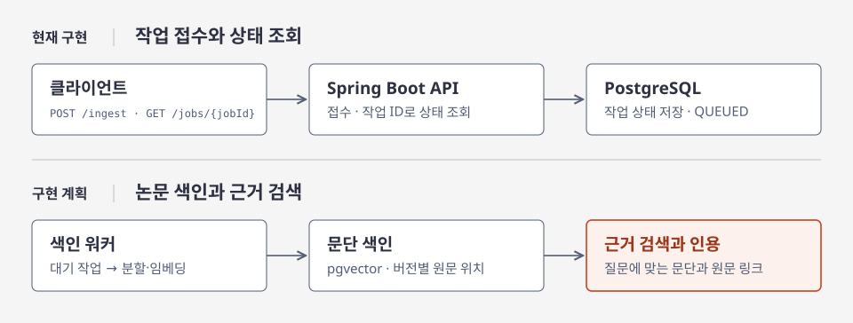

# PaperShelf

PaperShelf의 목표는 고성능 컴퓨팅(HPC) 논문에서 질문에 답하는 문단을 찾고, 해당 버전의 원문에서 근거를 확인하는 것이다. 예를 들어 “이 MPI 벤치마크는 몇 번 반복했는가?”라는 질문에는 실험 횟수와 함께 그 조건을 설명한 문단을 제시한다.

현재는 Spring Boot API가 논문 묶음의 적재 요청을 PostgreSQL에 `QUEUED`로 저장하고 작업 상태를 반환한다. 다음 단계에서는 워커가 논문을 문단 단위로 색인하고, 검색기가 질문에 맞는 문단을 찾아 인용한다.

## 아키텍처



## 측정 지표

- 색인 처리량(편/s)은 검색 가능해진 고유 논문 수를 전체 적재 시간으로 나눈 값이다. 같은 논문 묶음에서 워커 수와 배치 크기를 각각 바꿔 비교한다.
- 색인 지연 p95(ms)는 논문별 접수부터 색인 공개 커밋까지 걸린 시간의 95백분위수다. 같은 적재 부하에서 비교하며 HTTP `202` 응답 시간은 따로 기록한다.
- 검색 지연 p95·p99(ms)는 질문 임베딩 시작부터 검색 순위 확정까지 걸린 시간의 95·99백분위수다. 같은 질문과 요청 빈도로 색인 병행 여부를 바꾸고, 느려진 구간을 GC 정지·락 대기·DB 연결 대기와 대조한다.
- 정답 문단 재현율(Recall@5, %)은 질문마다 전체 정답 근거 중 상위 5개 결과에 포함된 비율을 구해 평균한 값이다. 같은 정답셋에서 벡터 단독 검색과 벡터·키워드 결합 검색을 비교하고 검색 p95도 함께 기록한다.

첫 비교는 논문 20편과 사람이 근거 문단을 표시한 질문 10개로 시작한다. [전체 실험 설계](docs/hpc-rag-spring-implementation-plan.md)

## 로컬 실행

Java 21과 Docker Compose를 사용한다. 프로젝트 루트에서 실행한다. DB 볼륨을 다시 사용할 때는 처음 설정한 로컬 비밀번호를 사용한다.

```bash
export PAPERSHELF_DB_PASSWORD='choose-a-local-password'
docker compose up -d --wait
./gradlew test
./gradlew bootRun
```

API는 기본 `http://localhost:8080`, DB는 `127.0.0.1:15433`에서 열린다. 서버 상태는 `GET /actuator/health`로 확인한다. 다른 클라이언트에서 호출하려면 접근 가능한 서버 주소를 사용한다. 현재 API는 로컬 개발용이며 인증을 구성하기 전에는 공개 인터넷에 노출하지 않는다.

## 적재 접수와 조회

아래 명령은 같은 `runId`에서 `demo-01` 묶음을 접수한다. `runId`는 UUID, `shardId`는 1~128자의 공백이 아닌 문자열이다. 같은 두 값을 다시 보내면 같은 `jobId`를 반환한다.

```bash
curl -i http://localhost:8080/ingest \
  -H 'Content-Type: application/json' \
  -d '{"runId":"4c051714-1841-47c7-a265-81d0f8070da4","shardId":"demo-01"}'
```

응답 예시

```http
HTTP/1.1 202 Accepted
Location: /jobs/087b49aa-296c-45c1-a99a-b07ce86f1333
Content-Type: application/json

{"jobId":"087b49aa-296c-45c1-a99a-b07ce86f1333","runId":"4c051714-1841-47c7-a265-81d0f8070da4","shardId":"demo-01","status":"QUEUED"}
```

반환된 `Location`에 GET을 보내면 `200 OK`와 같은 형식의 JSON을 받는다. 잘못된 UUID나 빈 `shardId`는 `400`, 존재하지 않는 작업 ID는 `404`이며 오류 본문은 `application/problem+json`이다.

## 팀 코드 읽기

1. [IngestionController](src/main/java/io/github/kimgt0128/papershelf/ingest/IngestionController.java)에서 두 HTTP 경로와 `ResponseEntity` 상태·헤더를 본다. [SubmitIngestRequest](src/main/java/io/github/kimgt0128/papershelf/ingest/SubmitIngestRequest.java)와 [IngestJob](src/main/java/io/github/kimgt0128/papershelf/ingest/IngestJob.java)은 요청·응답 필드를 정의하는 Java 21 `record`다.
2. [IngestJobStore](src/main/java/io/github/kimgt0128/papershelf/ingest/IngestJobStore.java)는 접수와 조회 SQL을 소유한다. DB 유일 제약과 `ON CONFLICT`가 중복 접수를 처리한다. 스키마는 [Flyway 마이그레이션](src/main/resources/db/migration/V1__create_ingest_jobs.sql)에 있다.
3. [StageLoggingAspect](src/main/java/io/github/kimgt0128/papershelf/logging/StageLoggingAspect.java)는 Spring 빈의 `@LogStage` 메서드가 호출되면 콘솔에 JSON 한 줄을 남긴다. 첫 적용 지점은 `IngestJobStore.submit()`이다. `message`는 `stage.completed` 또는 `stage.failed`이고, 공통 필드는 `stage`와 `elapsed_ms`다. 실패에는 `error_type`도 있다. 인자와 반환값은 기록하지 않는다.
4. [IngestionApiTest](src/test/java/io/github/kimgt0128/papershelf/ingest/IngestionApiTest.java)는 접수·조회·중복·오류 응답을 검증한다. [StageLoggingAspectTest](src/test/java/io/github/kimgt0128/papershelf/logging/StageLoggingAspectTest.java)는 로그를 남겨도 반환값과 예외가 호출자에게 그대로 전달되는지 확인한다.

`stage.completed`는 동기 메서드가 반환된 시점을 뜻한다. 향후 `paper.published`는 색인이 검색 가능해진 DB 커밋 이후에 별도 이벤트로 기록한다. 비동기 작업을 도입할 때는 워커에서 실제로 실행하는 단계에 `@LogStage`를 붙인다.
