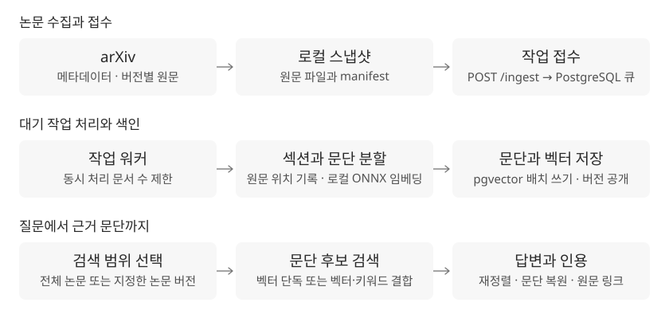

# HPC 논문 RAG와 HotSpot 성능 실험 구현 계획

첫 시연의 목표는 **논문 한 편이 검색 가능해지기까지 어디서 시간이 걸렸는지 보고, 질문 하나가 실제로 어떤 문단을 찾았는지 원문에서 확인하는 것**이다. 이 경로를 20편에서 먼저 완성한다. 이후 100편으로 후보를 줄이고, 같은 입력을 반복할 수 있을 때 1,000편 이상으로 확장한다. 아래의 수량·설정은 실험 시작값이며 성능 수치는 측정 후 채운다.

## 1. 첫 시연과 구현 순서

| 순서 | 구현 범위 | 팀이 직접 확인할 중간 결과 | 다음 단계로 넘어가는 기준 |
|---|---|---|---|
| ① 논문 1편 | 버전 고정 HTML → 섹션·문단 → 로컬 임베딩 → pgvector exact 검색 | 질문의 상위 5개 문단, 섹션 제목, 원문 링크, 검색에 걸린 시간 | 원문에서 인용한 문단을 다시 열 수 있다. 같은 입력을 재처리해도 청크 수가 같다. |
| ② 20편, 수작업 질문 10개 | 적재 API·Grafana·JSON 로그, 버전 고정 검색, 벡터 단독/하이브리드 A/B | 적재 진행률과 질문별 후보 20개·최종 5개·실제 인용을 본다. | 입력·완료 건수를 대조하고 두 검색 방식의 정답 문단 Recall@5와 검색 p95를 비교한다. |
| ③ 100편 | 고정 코퍼스, 성능용 모의 임베딩과 품질용 실제 임베딩, 청킹·큐·배치 후보 실험 | 설정별 처리량–Recall 산점도, 단계별 p95, 실패 질문 목록, JFR 한 건 | 같은 입력·설정의 반복 편차를 확보하고 가장 비싼 단계와 다음 대조 실험을 고른다. |
| ④ 1,000편 이상 | 상위 후보, 4개 기법의 단독·조합, 색인 중 검색 부하, 정답셋 확장 | 반복별 결과표, 검색 p99, GC와 락 증거, 실패·중복 검증 | 유효한 설정만 비교하고 발표할 결론마다 원본 실행과 반례를 연결한다. |
| ⑤ 일일 업데이트 | 신규·개정·중복·재시작 재현, 검색 중 버전 교체 | v2 공개 후에도 v1 상세 질문은 v1, 전체 검색은 v2를 인용하는 시연 | 전환 실패, 역순 도착, 중복 수집에서도 활성 버전과 청크 수가 맞는다. |

**첫 골드 문항 예시.** `cs.DC` 논문 `2508.13397v1`에 대해 “저자들은 §4.1의 MPI 실험에서 재현성을 어떻게 확인했고 그림에는 무엇을 표시했는가?”라고 묻는다. 정답은 벤치마크를 각각 10회 실행했고 그림의 오차 막대로 실행 간 변동을 나타냈다는 것이다. 정답 근거는 §4.1 첫 문단이다. 같은 논문을 찾았어도 초록의 2.45배 가속 수치만 인용하면 이 문항은 오답이다. 아래 성능 실험에서 사용하는 반복 횟수와 이 논문의 답은 독립적이다. [논문 원문 §4.1](https://arxiv.org/html/2508.13397v1#S4.SS1)

## 2. 아키텍처와 코드 경계

초기 구성은 실험 전용 **Spring Boot 앱 1개, PostgreSQL + pgvector 1개, Prometheus, Grafana**다. 원문은 로컬 파일, 실행 기록은 실행별 디렉터리에 보관한다. 하나의 앱에서 API와 작업자가 동작하면 동일한 JVM의 요청·작업 객체와 GC를 함께 관측할 수 있다. JMH만 별도 프로세스로 실행한다. 외부 수집 → 로컬 스냅샷 생성 시간과 고정 스냅샷 → 검색 가능 상태까지의 시간은 각각 기록한다.



현재 구현 범위는 작업 접수와 상태 조회다. 이후 워커는 분할한 문단의 메타데이터와 벡터를 저장하고, 검색기는 선택한 버전의 원문에서 인용할 문단을 복원한다. 워커와 검색 단계의 지표는 Actuator와 Prometheus로 수집해 Grafana에서 보고, 실행별 JSON 로그·GC 로그·JFR로 지연 원인을 확인할 계획이다.

PaperShelf는 Java 21과 Spring Boot를 사용한다. 큐를 구현할 때는 짧은 선점 트랜잭션과 lease token을, 논문 검색에는 버전과 벡터 차원 필터를 적용할 계획이다. 실행 가능한 범위는 [README](../README.md)에 기록한다.

### 클래스 파일별 역할

실험 앱에는 기능별 Java 패키지를 둔다. 다음 표의 각 이름은 별도 파일이다. 순서가 바뀌는 이유, 저장 방식이 바뀌는 이유, 실험 알고리즘이 바뀌는 이유를 서로 다른 클래스에 둔다. DTO와 값 객체는 Java `record`로 표현한다.

| 패키지·파일 | 한 가지 책임과 대표 메서드 | 의존 및 교체 경계 |
|---|---|---|
| `corpus/ArxivHarvester.java` | 카테고리별 OAI 페이지와 체크포인트를 읽어 변경 후보를 찾는다. `harvest()` | HTTP·수집 상태만 다룬다. |
| `corpus/CorpusManifest.java` | 각 문서의 ID·버전·원문 파일·해시·라이선스를 묶은 고정 입력을 읽는다. `papers(shardId)` | 적재는 이 목록으로 시작한다. |
| `ingest/IngestionController.java` | 요청을 검증하고 작업 ID·상태 조회 주소를 반환한다. `submit()` | `IngestJobStore`만 호출한다. |
| `ingest/IngestJobStore.java` | 접수·선점·lease 갱신·재시도·종료 상태를 짧은 트랜잭션으로 변경한다. | 큐 SQL과 멱등 키를 소유한다. |
| `ingest/WorkerLeaseHeartbeat.java` | 긴 작업의 lease 갱신을 예약하고 소유권 상실을 워커에 알린다. `start()` | 갱신 SQL은 `IngestJobStore`에 위임한다. |
| `ingest/IngestionWorker.java` | 빈 실행 슬롯에서 작업을 선점하고, 작업 수명과 실패를 관리한다. `runOnce()` | `IngestJobStore`, `ShardRunner`를 호출한다. |
| `ingest/ShardRunner.java` | 한 묶음의 고정 문서 목록을 제한된 동시성으로 배부하고 결과를 모은다. `process()` | `WorkCursor`와 `PaperIndexer`를 사용한다. |
| `ingest/WorkCursor.java` | 공유 목록에서 다음 문서 번호 하나를 배부한다. `nextIndex()` | `SynchronizedCursor`가 기준. TAS·TTAS·Backoff·atomic 대조군은 이 인터페이스를 구현한다. No Lock은 검증 프로필 전용이다. |
| `index/PaperIndexer.java` | 한 편의 파싱 → 분할 → 임베딩 → 저장 → 공개 순서를 보장한다. `index()` | 아래 구성요소를 조합한다. 토큰 계산·SQL은 해당 클래스가 담당한다. |
| `index/PaperHtmlParser.java` | 고정 HTML에서 섹션 경로·문단·앵커·원문 위치를 만든다. `parse()` | 파싱만으로 테스트할 수 있다. |
| `index/PassageChunker.java` | 원문 범위를 추적할 수 있는 child를 만든다. `split()` | `FixedWindowChunker`, `SectionAwareChunker`가 동일 입력을 받는다. |
| `index/PaperMetadataEnricher.java` | 초록·키워드·기술적 문제를 출처와 함께 부착한다. `enrich()` | 기준 설정은 결정적 추출. 모델 보강은 설정으로 분리한다. |
| `index/PassageVectorWriter.java` | 이미 계산된 벡터와 child–문단 연결을 JDBC 배치로 저장한다. `upsertBatch()` | 모델 호출은 Spring AI `EmbeddingModel`이 담당한다. |
| `index/PaperVersionStore.java` | staging 문단과 버전 상태를 관리하고 완전한 버전만 공개한다. `activateIfComplete()` | 문서 수·체크섬·현재 작업 권한·버전 순서를 DB에서 검증한다. |
| `search/PaperPassageRetriever.java` | 요청 범위에서 벡터 후보를 찾고, 하이브리드 설정에서는 키워드 후보와 순위를 합친다. `retrieve()` | Spring AI `DocumentRetriever`를 구현한다. 두 검색 경로에 같은 논문·버전 조건을 적용한다. |
| `search/ParentContextPostProcessor.java` | 선택한 child의 이웃 문단을 복원하고 중복·컨텍스트 예산을 처리한다. `process()` | 버전 고정 문단을 일괄 조회한다. 재정렬 점수는 별도 post-processor가 계산한다. |
| `search/ParagraphReader.java` | 지정한 버전·문단 ID의 원문과 이웃을 한 번의 조회로 읽는다. `readWindows()` | 거리 순위와 프롬프트 예산은 호출자가 관리한다. |
| `search/QuestionService.java` | 질문을 Advisor에 전달하고 답변의 인용 ID를 실제 전달 문단과 대조한다. `answer()` | 검색만 보는 진단 API는 같은 retriever·post-processor를 호출한다. |
| `experiment/RunRecorder.java` | 입력·환경·시점·설정·측정 결과를 실행 디렉터리에 남긴다. | 검색과 적재 알고리즘을 결정하지 않는다. |
| `experiment/RetrievalEvaluator.java` | 정답셋과 실제 순위를 비교해 질문별·전체 점수를 낸다. | 프롬프트 생성과 분리해 저장된 검색 결과로 재채점할 수 있다. |

**팀 코드 리딩 순서**는 적재의 경우 `IngestionController → IngestJobStore → IngestionWorker → ShardRunner → PaperIndexer`, 검색의 경우 `QuestionService → RetrievalAugmentationAdvisor → PaperPassageRetriever → ParentContextPostProcessor`다. 이미 Spring AI가 제공하는 `EmbeddingModel`, `DocumentRetriever`, `DocumentPostProcessor`를 그대로 쓰고, 자체 전략 인터페이스는 실제 비교 대상인 작업 배부와 청킹에 먼저 둔다. 패키지 전체를 인터페이스/구현 쌍으로 복제할 필요가 없다.

## 3. 코퍼스와 문단 주소

| 용도 | 데이터와 수집 방식 | 기록·확인할 내용 |
|---|---|---|
| 빠른 품질 실험 | `cs.DC`, `cs.PF` 중심으로 버전 고정 HTML 20편. 큰 문서·수식·표·중첩 섹션을 포함한다. `cs.OS`, `cs.PL`은 시스템·런타임 주제부터 추가한다. | 파일 크기, 카테고리, 파싱 성공률, 본문 없는 사유. HTML의 같은 버전을 구할 수 없는 문서는 별도 집계한다. |
| 누적 메타데이터 | arXiv OAI-PMH `ListSets`로 집합을 확인한 후 `ListRecords`와 `resumptionToken`으로 순회한다. 카테고리 교차 등재는 arXiv ID·버전으로 합친다. | OAI datestamp는 레코드 변경 시각이다. 논문의 최초 제출일·개정 시각을 별도로 저장한다. [arXiv OAI](https://info.arxiv.org/help/oa/index.html) |
| 대규모 본문 | 무료 경로 후보인 Common Pile arXiv 텍스트를 ID로 매칭해 성능용 고정 스냅샷을 만든다. 품질셋에는 원문 버전·문단 대응을 검증한 자료만 쓴다. Kaggle의 메타데이터 JSON과 본문 파일은 구분한다. | 원문 버전을 확인할 수 없는 텍스트는 스냅샷 해시로 식별하고 버전 정답셋에서 제외한다. arXiv S3는 Requester Pays이다. 원문 배포·인용은 문서별 라이선스와 출처 링크를 따른다. [데이터 카드](https://huggingface.co/datasets/common-pile/arxiv_papers) · [arXiv bulk](https://info.arxiv.org/help/bulk_data.html) · [S3 안내](https://info.arxiv.org/help/bulk_data_s3.html) |
| 저널·학회 정보 | 필요할 때 DOI/arXiv ID로 OpenAlex·Semantic Scholar를 조회해 TPDS·SC·PPoPP 등을 표시한다. CORE는 원문 누락 보강 후보다. | 게재처·연결 근거·조회일·미확인을 저장한다. API 한도나 결과 누락이 초기 적재를 막지 않게 보강은 캐시하고 나중에 재시도한다. [OpenAlex](https://help.openalex.org/api/) · [Semantic Scholar API](https://webflow.semanticscholar.org/product/api) |

원문 파일을 한 번 받아 SHA-256을 고정하고 각 성능 실행은 로컬 사본에서 시작한다. HTML은 섹션·문단 경계를 보존하고 참고문헌·사이트 탐색·중복 렌더링을 식별한다. 수식·표 캡션을 포함할지 파서 버전과 함께 고정한다. PDF/LaTeX 대체 파서는 해당 형식의 문단 대응을 검증한 뒤 추가한다. 카테고리·연도·크기별 선정 수와 탈락 수를 기록해야 HTML이 잘 변환되는 논문에 치우친 정도를 설명할 수 있다.

| 저장 단위 | 핵심 필드 | 쓰임 |
|---|---|---|
| `paper`, `paper_version` | `arxiv_id, version, submitted_at, updated_at, categories[], doi, venue, source_uri, license, raw_sha256, parser_version, abstract_or_summary, technical_problem, enrichment_source` | 초록을 기본 주제 요약으로 사용한다. 문제 진술·문단 요약·키워드는 원문 추출/모델 생성/미확인을 표시한다. |
| `section`, `paragraph` | `version_id, section_id, parent_section_id, section_path, paragraph_id, ordinal, text, normalized_start, normalized_end, source_anchor, paragraph_uri, summary, keywords` | 오프셋은 해당 버전의 정규화된 UTF-8 본문 바이트 기준 반개구간 `[start,end)`. DOM 앵커가 없으면 내부 문단 뷰어가 이 스냅샷을 연다. |
| `chunk`, `chunk_span` | `chunk_id, index_generation, version_id, section_id, text, tokens, model_revision, dimensions, vector`. 연결 테이블에 `chunk_id, paragraph_id, start, end` | 여러 문단이 한 청크에 들어가거나 긴 문단 하나가 여러 청크로 나뉘어도 인용할 범위를 보존한다. |
| `paper_active`, `ingest_job` | `corpus_id, arxiv_id, active_generation`; 작업에는 `run_id, shard_id, status, lease_token, lease_until, attempt, last_error` | 활성 포인터와 작업 이력이 분리되어 재시도·개정·새 모델 색인을 구별할 수 있다. |

문단 ID는 버전·파서 버전·섹션 경로·문단 순번에서, 청크 ID는 색인 세대·문단 범위·청킹 설정에서 결정적으로 만든다. `index_generation`은 원문 버전·파서·청커·임베딩 모델/설정을 포함한다. 보고서의 링크는 `/papers/{id}/versions/{v}/paragraphs/{paragraphId}`와 실제 원문 URI를 함께 제공한다.

## 4. Spring Boot 구현 골격

다음 코드는 **호출 경계 예시**다. 프로젝트 전용 타입의 구현·생성자 주입·일부 예외 처리는 생략했다. 첫 실행은 Spring MVC, JDBC, Flyway, Actuator, Prometheus registry, Spring AI RAG·Transformers 모듈을 사용한다. 모델 파일과 토크나이저는 미리 받아 버전을 고정한다.

기본 접수·조회 API는 [IngestionController](../src/main/java/io/github/kimgt0128/papershelf/ingest/IngestionController.java)와 [IngestJobStore](../src/main/java/io/github/kimgt0128/papershelf/ingest/IngestJobStore.java)에 구현했다. 요청·응답 JSON과 호출 예시는 [README](../README.md)에 있다. 아래의 워커와 검색 코드는 다음 단계의 설계다.

`POST /ingest` 본문에는 원문 대신 manifest의 참조를 넣는다. 새 입력을 전송해야 하면 파일로 스트리밍하고 해시·길이를 확정한 후 접수한다. `(run_id, shard_id)` 유일 제약으로 중복 요청에는 기존 ID를 반환한다. 새 작업의 대기열 한도는 접수 트랜잭션 안에서 원자적으로 예약하고 한도 초과 시 `429 + Retry-After`를 반환한다. `GET /jobs/{id}`는 상태, 대상 수, 완료·실패·건너뜀 수, 최근 오류를 반환한다.

```java
// IngestionWorker.java — 고정 개수의 작업 슬롯 각각이 이 메서드를 호출한다.
void runOnce() {
    jobs.claimNext().ifPresent(claim -> {
        try (var renewal = heartbeat.start(claim)) {
            var result = runner.process(claim);       // 작업 중 DB 커넥션을 잡아두지 않는다.
            jobs.finishIfOwner(claim, result);
        } catch (Exception failure) {
            jobs.retryOrFailIfOwner(claim, failure);  // 오류 유형·시도 횟수·다음 시각을 기록한다.
        }
    });
}

// ShardRunner.java — 모든 배부 전략에서 동일하게 호출되는 문서 워커의 본체
void processWindow(Claim claim, List<PaperRef> papers, WorkCursor cursor) {
    for (int i = cursor.nextIndex(); i < papers.size(); i = cursor.nextIndex()) {
        indexer.index(claim, papers.get(i));
    }
}
```

한 작업은 한정된 논문 묶음(shard)이다. `ShardRunner`가 묶음당 **하나의 커서**를 만들어 같은 목록·커서를 문서 워커들에게 전달하고 전부 끝날 때까지 기다린다. 프로세스 전체의 동시 문서·ONNX 호출·DB 쓰기 상한을 각각 둔다. 작업 선점 루프와 문서 워커의 executor를 분리해 부모 작업이 같은 풀의 자식 작업을 기다리며 모든 슬롯을 차지하는 경우를 막는다. DB 선점은 `FOR UPDATE SKIP LOCKED` 뒤 즉시 커밋한다. 문서 인덱싱 중에는 lease를 갱신하고, 소유권이 바뀌면 이전 워커가 저장을 공개하거나 작업을 종료할 수 없게 한다.

재시작 시에는 `(run_id, paper_ref)`별 처리 장부에서 성공 문서를 건너뛴다. 영구 파싱 오류는 해당 문서에 사유를 남기고 나머지 문서를 계속 처리한다. 일시적 DB·I/O 실패만 제한 횟수 내에서 재시도한다. 묶음이 끝나면 장부의 고유 문서와 manifest를 대조해 최종 상태를 정한다. DB의 upsert가 작업 번호 중복을 감출 수 있으므로 분배기 검증 실행에서는 쓰기 전 배부 횟수도 검사한다.

**임베딩과 DB 쓰기의 경계.** `PaperIndexer`는 한 편에서 나온 작은 청크 배치마다 `EmbeddingModel.embed(...)`를 한 번 호출한 뒤 `PassageVectorWriter.upsertBatch(...)`에 벡터를 바로 넘긴다. `embed`는 실제 추론, `db_write`는 DB 트랜잭션 커밋까지 타이머에 넣는다. Spring AI 2.0.2의 `PgVectorStore.doAdd()` 내부에는 이미 임베딩과 JDBC 배치가 들어 있다. 표준 `VectorStore.add()` 경로를 비교할 때는 그 전체를 `vector_add_total`로 기록하고 호출 전 별도 임베딩을 하지 않는다. [Spring AI 2.0.2 구현](https://github.com/spring-projects/spring-ai/blob/v2.0.2/vector-stores/spring-ai-pgvector-store/src/main/java/org/springframework/ai/vectorstore/pgvector/PgVectorStore.java)

```java
// ParentContextPostProcessor.java
final class ParentContextPostProcessor implements DocumentPostProcessor {
    private final ParagraphReader paragraphs;
    private final int tokenBudget;

    ParentContextPostProcessor(ParagraphReader paragraphs, int tokenBudget) {
        this.paragraphs = paragraphs;
        this.tokenBudget = tokenBudget;
    }

    @Override
    public List<Document> process(Query query, List<Document> hits) {
        // child가 가리키는 version_id로 조회한다. active 포인터를 다시 조회하지 않는다.
        var windows = paragraphs.readWindows(hits);
        return renderDistinctInRankOrder(hits, windows, tokenBudget);
    }
}

// RagConfiguration.java
@Bean
RetrievalAugmentationAdvisor paperAdvisor(PaperPassageRetriever retriever,
        ParentContextPostProcessor parents) {
    return RetrievalAugmentationAdvisor.builder()
            .documentRetriever(retriever)
            .documentPostProcessors(parents)
            .build();
}
```

`QuestionService`는 이 Advisor를 `ChatClient` 호출에 등록한다. 기준 경로는 child top-5 → 부모 섹션 안에서 해당 문단과 양옆 한 문단 → 실제 전달 문단 ID를 붙인 프롬프트다. 동일 문단을 한 번만 넣고 관련 순위와 토큰 예산(시작값 1,500)을 지킨다. 재정렬 실험에서는 동일 후보 top-20을 받아 `documentPostProcessors(reranker, parents)`로 상위 5개를 복원한다. 근거가 없으면 정보 부족을 반환하고 인용 ID가 실제 전달 목록에 속하는지 서버가 확인한다. 질문별로 최초 검색·재정렬·확장 후 문단 목록을 각각 남긴다. [Advisor 2.0.2 소스](https://github.com/spring-projects/spring-ai/blob/v2.0.2/spring-ai-rag/src/main/java/org/springframework/ai/rag/advisor/RetrievalAugmentationAdvisor.java) · [DocumentPostProcessor 2.0.2](https://github.com/spring-projects/spring-ai/blob/v2.0.2/spring-ai-rag/src/main/java/org/springframework/ai/rag/postretrieval/document/DocumentPostProcessor.java)

`TokenTextSplitter`는 고정 길이 기준선에 활용하되 실제 임베딩 토크나이저로 길이를 재검사한다. 문단 범위와 overlap은 자체 청커가 명시적으로 보존한다. `KeywordMetadataEnricher`·`SummaryMetadataEnricher`로 모델 기반 보강을 돌릴 때는 모델·프롬프트·출력 해시를 저장한다. 보강 결과 캐시와 실측 시간을 구분해 비교 도중 뒤에서 발생하는 LLM 호출을 제거한다. [Spring AI ETL](https://docs.spring.io/spring-ai/reference/api/etl-pipeline.html)

## 5. 첫 실행부터 보는 화면과 로그

팀원이 먼저 열 곳은 두 군데다. **Grafana의 적재 화면**은 “어디가 늦는가?”에 답하고, **Spring Boot의 질문 결과 화면**은 “무슨 원문을 왜 보여 주었는가?”에 답한다. 후자는 `GET /experiments/runs/{runId}/questions/{questionId}`에서 HTML 또는 같은 내용의 JSON을 제공한다. 정답 문단, 검색된 child 순위·거리, 복원된 문단, 모델 인용을 한 행에서 대조한다. 최초 20편은 매 문서 공개 후 진행 상태를 갱신하고, 평가 문서가 모두 준비된 시점에 질문 평가를 실행한다.

| 패널 | 그래프·집계 방법 | 보고 나서 할 판단 |
|---|---|---|
| 적재 진행 | 시간축에 대상·접수·검색 가능·실패 수. 아래에 대기 문서 수, 가장 오래 기다린 작업의 나이, 처리 중 문서 수 | 접수만 앞서가는지, 실제로 문서가 공개되고 있는지 구별한다. |
| 단계별 지연 | `queue_wait, parse, chunk, enrich, embed, db_write, publish`별 p50/p95와 처리 건수. GC 정지 구간을 같은 시간축에 표시 | ONNX 호출·DB 커밋·큐 대기 중 어떤 단계부터 다음 실험을 할지 고른다. 병렬 단계의 p95를 합산해 총시간을 구하지 않는다. |
| JVM과 DB | 사용 힙 및 GC 직후 사용량, 프로세스 RSS, CPU, GC 정지, DB 풀 사용·획득 대기, 커밋 rows/s | 배치를 늘렸을 때 추론 CPU·네이티브 메모리·DB 풀 중 먼저 포화되는 자원을 찾는다. |
| 검색과 품질 | 검색·첫 토큰·전체 답변 p95/p99, 요청/오류 수. 설정별 x축 docs/s, y축 Recall@5, 점 옆에 실제 질문 수와 프롬프트 토큰 수 | 속도가 오른 설정에서 정답 문단이 빠졌는지 바로 해당 질문을 연다. |
| 락 진단 | 작업자 수별 올바르게 완료된 docs/s와 CPU, 별도 진단 실행의 모니터 대기 합계·건수·상위 스택. JMH 결과는 옆 패널 | 미세 실험의 순위가 실제 적재에서도 유지됐는지 본다. |

Boot에 `spring-boot-starter-actuator`와 `micrometer-registry-prometheus`를 추가하고 로컬 수집 대상에 `/actuator/prometheus`를 노출한다. `Timer`에는 히스토그램을 활성화한다. 문서별 영속 상태와 완료 이벤트가 정확한 실행 집계의 원본이고, Prometheus는 라이브 추세를 보여 준다. 5초 scrape보다 짧은 작업도 볼 수 있도록 `RunRecorder`가 실행 종료 시 완료 수·단조 시계 경과 시간과 단계별 누적 히스토그램을 별도로 저장한다. [Spring Boot Actuator](https://docs.spring.io/spring-boot/4.1/reference/actuator/metrics.html) · [Micrometer 히스토그램](https://docs.micrometer.io/micrometer/reference/concepts/histogram-quantiles.html)

```yaml
management:
  endpoints:
    web:
      exposure:
        include: health,prometheus
  metrics:
    distribution:
      percentiles-histogram:
        rag.stage.duration: true
        rag.search.duration: true
logging:
  structured:
    format:
      console: logstash
```

```promql
sum(rate(rag_documents_published_total[1m]))
histogram_quantile(0.95, sum by (le, stage) (rate(rag_stage_duration_seconds_bucket[2m])))
```

`rag.documents.published`는 공개 커밋 성공 뒤 증가시킨다. `rag.stage.duration`은 성공과 실패를 구분하고 패널에서 outcome을 선택할 수 있게 한다. 지표 태그는 `stage, outcome, mode`처럼 값 종류가 적은 항목만 사용한다. 라이브 실험은 인스턴스당 한 번씩 실행해 시간 범위로 대조한다. `run_id, job_id, paper_id, question_id, attempt`는 구조화 로그에 명시적으로 싣는다. 다른 실행기로 넘길 때도 작업 컨텍스트로 전달한다. [Prometheus 분위수](https://prometheus.io/docs/prometheus/latest/querying/functions/#histogram_quantile) · [Spring Boot 구조화 로그](https://docs.spring.io/spring-boot/4.1/reference/features/logging.html)

**로그 예시**는 필드 모양을 보여 주는 가상 이벤트다. 정상 실행은 문서 완료·상태 전환·주기적 집계만 남기고 실패는 단계·원인·재시도 정보를 모두 남긴다. 본문·프롬프트·벡터 대신 참조 ID를 기록한다. 짧은 진단 실행에서만 배치별 세부 로그를 켠다.

```json
{"event":"paper.published","run_id":"example","job_id":"shard-01","paper_id":"2508.13397","version":1,"attempt":1,"outcome":"success","paragraphs":46,"chunks":58,"elapsed_ms":2140}
```

| 실행 폴더 `runs/{runId}/`의 파일 | 담을 내용 |
|---|---|
| `manifest.json` | Git SHA, 데이터·정답셋 해시, 모델·토크나이저 revision, 실제 벡터 차원, JVM 전체 버전·플래그, CPU/메모리 한도, DB·인덱스 설정, 배치·풀 크기, 시드, 시작·종료 시각 |
| `events.jsonl`, `stages.csv` | JSON 로그와 단계별 단위(문서/배치/요청), 표본 수, 실패 수, 분포. 콘솔 JSON은 실행기가 파일로 수집한다. |
| `questions.jsonl`, `summary.csv` | 질문별 검색 범위·방식·검색 시간, 후보 20개와 최종 5개의 청크 ID·순위, 정답 근거별 최초 적중 순위, 확장 후 인용·답변 판정. 요약에는 방식별 Recall@5·검색 p95·표본 수를 남긴다. |
| `gc.log`, `profile.jfr` | 실행 경계에 맞춘 GC 로그, 선택한 기준·이상·개선 실행의 JFR. 파일별 수집 프로필·샘플 간격·이벤트 임계값을 기록한다. |

실행기가 워밍업 후 같은 JVM에서 `jcmd <pid> JFR.start name=rag settings=profile`로 시작하고, 측정 종료 후 `jcmd <pid> JFR.stop name=rag filename=<절대경로>/profile.jfr`로 저장한다. `jfr summary`로 이벤트 유무를 확인하고 JDK Mission Control 또는 `jfr print --events jdk.JavaMonitorEnter,jdk.ThreadPark,jdk.SocketRead,jdk.ObjectAllocationSample`으로 스택을 본다. GC 로그는 JVM 시작 때 `-Xlog:gc*,safepoint:file=gc.log:time,uptime,level,tags`로 켠다. JFR을 켠 쌍끼리 비교하고 계측 꺼짐/켜짐 한 쌍으로 비용을 확인한다. [Oracle jcmd](https://docs.oracle.com/en/java/javase/21/docs/specs/man/jcmd.html) · [Oracle jfr](https://docs.oracle.com/en/java/javase/21/docs/specs/man/jfr.html)

## 6. 처리 성능 실험

**측정 구간.** `accept_ms`는 클라이언트 전송부터 응답까지, `queue_wait_ms`는 DB 접수부터 선점까지, `paper_visible_ms`는 접수부터 해당 논문이 검색 대상이 된 커밋까지다. 코퍼스 총시간은 첫 요청 전송부터 마지막 대상의 공개·최종 실패까지 벽시계 경과 시간이다. `docs/s = 고유 공개 문서 수 / 총시간`, `chunks/s = 공개된 고유 child 수 / 총시간`으로 산출한다. 실패·재시도·중복·누락은 따로 세며 완전성 기준을 통과한 실행만 속도 순위에 넣는다. 초당 입력 바이트와 실제 임베딩 토큰 수도 남겨 청크를 잘게 나눈 설정의 chunks/s를 해석한다.

**환경 세 가지.** ① 고정 시드의 동일 차원·비영벡터를 반환하는 인프로세스 stub은 파싱·할당·쓰기 측정에 쓴다. ② 고정 응답 바이트와 지연(예시 0/50ms)을 갖는 로컬 HTTP mock은 소켓 대기와 동시성 비교에 쓴다. ③ 로컬 ONNX는 실제 추론과 검색 품질을 평가한다. 원격 API를 쓰는 생성 실험은 별도 열로 보고한다. ONNX 모델 워밍업, intra/inter-op 스레드 수, CPU quota, 메모리와 RSS를 기록한다. ONNX의 네이티브 추론 CPU·메모리가 JVM 힙 바깥에서도 소비되기 때문이다. [Spring AI ONNX](https://docs.spring.io/spring-ai/reference/api/embeddings/onnx.html) · [ONNX Runtime 스레드](https://onnxruntime.ai/docs/performance/tune-performance/threading.html)

**공통 기준 B0.** 같은 manifest, 같은 DB 초기 스냅샷, 한 종류의 모델·색인, 같은 고정 JVM 힙(`-Xms = -Xmx`), G1, 플랫폼 스레드, `synchronized` 커서, 고정 문서 슬롯 수, 고정 배치 8에서 시작한다. 동기 B0도 먼저 접수 시각을 영속화한 뒤 요청이 같은 `ShardRunner`의 종료를 기다린다. 비동기 대조와 동일한 참조 입력·공유 실행 한도·pgvector 쓰기 코드를 쓴다. 호스트에 맞춰 힙·슬롯을 처음 한 번 정하고 manifest에 남긴다.

| 축 | 단독 실험과 세부 대조 | 관찰값과 판정 |
|---|---|---|
| A. 비동기 접수·백프레셔 | B0 → 같은 동시성에서 DB 큐·202만 적용 → 대기열과 in-flight 상한 변경. 큰 HTTP 본문 효과는 같은 비동기 설정에서 `inline body`와 `manifest ref`를 별도 비교한다. | accept p95, 공개 p95, 완주 시간, backlog·429, 최대 사용 힙. 요청 스레드와 worker의 할당을 따로 기록하고 전체 bytes/완료 문서도 산출한다. |
| B. 할당·GC | `batch=1/8/32`를 G1에서 스윕, 같은 배치에서 G1와 generational ZGC 비교. Java 21은 각각 `-XX:+UseG1GC`, `-XX:+UseZGC -XX:+ZGenerational`. 검색 힙은 적재를 고정하고 topK=3/5/10, 컨텍스트 예산 고정/변경을 별도로 본다. | 할당 bytes/doc, String·List·Document 할당 스택, 최대 관측 힙·RSS, GC 직후 생존량, GC pause 합계/p99·처리량. young 횟수·승격량은 각 collector에서 제공하는 동등한 지표만 같은 축에 둔다. [OpenJDK ZGC](https://wiki.openjdk.org/spaces/flyingpdf/pdfpageexport.action?pageId=34668579) |
| C. 공유 분배기 | No Lock, TAS, TTAS, Backoff, synchronized와 `AtomicInteger.getAndIncrement()` 대조군. 2/4/8/16/32 workers. 먼저 Java 합산 검증·JMH, 이후 동일 `WorkCursor`를 `ShardRunner`의 실제 문서 목록에 꽂는다. | 번호별 정확성, JMH 배부량, 실적재 docs/s, CPU, 커서 acquire 지연, 모니터 대기 스택. DB 선점 횟수·묶음 크기는 고정한다. |
| D. 스레드 모델 | 동일 동시 호출 상한·DB 풀에서 worker executor만 플랫폼 고정 풀과 virtual-thread-per-task로 교체한다. 검색 요청 부하에서는 MVC 요청 스레드 전환을 별도 비교한다. 각각 stub·지연 mock·ONNX 결과를 분리한다. | 완료 RPS, 검색 p95/p99, CPU, DB 풀 획득 대기, Semaphore 대기, `jdk.VirtualThreadPinned`. Java 21과 24+는 synchronized 내 블로킹 처리에 차이가 있어 JDK 버전을 실험 축에 섞지 않는다. [Java 21 가상 스레드](https://docs.oracle.com/en/java/javase/21/core/virtual-threads.html) · [JDK 24 변경점](https://docs.oracle.com/en/java/javase/25/migrate/significant-changes-jdk-24.html) |

**실행 수를 줄이는 순서.** 100편에서 축별 후보를 고른다. 본실험의 단독 행은 `B0, B0+A, B0+B, B0+C, B0+D`. 조합 행은 `A+B, A+B+C, A+B+C+D`이며 모두 B0에서 출발한다. B의 배치와 collector 등 축 내부의 효과는 바로 위 세부 대조로 분리한다. 마지막 조합이 좋아도 각 단독 효과의 합으로 설명하지 않는다. 조합에서만 차이가 크면 해당 두 축의 2×2를 추가한다.

**재현 조건.** 워밍업은 별도 입력으로 하고 측정 DB를 같은 스냅샷으로 복원한다. 워밍업 후 독립 JVM 실행을 조건별 최소 5회, 순서는 블록 안에서 무작위로 배치한다. 실행별 값을 모두 보존하고 중앙값·IQR과 가능하면 짝지은 차이의 구간을 보고한다. 자료가 적은 초기 20편에서 p99는 참고값으로만 표시한다. 검색 부하 테스트는 고정 도착률·동일 질의 목록으로 충분한 요청을 발생시켜 예정 시각부터 완료까지 클라이언트에서 측정하고 미발송·timeout·오류도 센다. 적재만, 검색만, 검색+적재 세 모드를 구분한다. GC/요청별 p99는 표본 수와 함께 싣고 실행별 p99를 평균내지 않는다.

### 락과 HotSpot을 검증하는 순서

1. 기존 C++ 실험과 동일한 정수 범위 1,000,000~5,000,000(양끝 포함)에서 정확히 4,000,001개, 합계 12,000,003,000,000을 확인한다. Java 합계는 `long`. 번호별 횟수까지 검사해 중복과 누락이 상쇄되는 오류도 잡는다. 검증 패스·시간 측정 패스를 분리한다. No Lock은 비원자적 읽기–증가–쓰기 비교용이며 정확성 실패는 별도 열에 남긴다. [기존 과제의 검증 방식](https://github.com/kimgt0128/lock-performance-comparison)
2. Java용 JMH에서 fork·warmup·measurement를 명시한다(시작값 3 fork, 워밍업 5회, 측정 5회). 같은 공유 상태에 경쟁하게 하고 반환값/체크섬을 소비한다. 고정 범위 완주 시간과 지속 경쟁 시 배부 ops/s를 구분한다. TAS는 원자 교환, TTAS는 읽은 뒤 획득 시도, Backoff는 실패 후 대기 정책까지 기록한다. 분배기 효과는 CPU time·실패한 획득 시도도 함께 본다. [OpenJDK JMH](https://github.com/openjdk/jmh)
3. 프로덕션 경로와 동일한 작업 채우기·문서 큐·실제 JDBC writer로 반복한다. 실제 논문은 번호 배부보다 처리 시간이 길 수 있다. 마이크로벤치의 차이가 실적재 반복 편차에 묻히면 그 사실이 발표 결과다. 배부를 일부러 과도하게 잘게 나눈 재현은 스트레스 시험으로 표시한다.
4. JFR에서 `jdk.JavaMonitorEnter`의 **모니터 클래스와 스택이 해당 분배기**인지 본다. profile 설정에는 지속 시간 임계값이 있어 짧은 경합이 빠질 수 있다. 짧은 진단 실행의 임계값을 낮추고 기준·변경 양쪽에 적용한다. 여러 스레드의 대기 합계는 벽시계 시간을 초과할 수 있다. CAS 스핀은 Java 모니터 이벤트에 잡히지 않으므로 CPU 샘플·획득 시도·처리량을 본다. [JDK 21 JFR 설정 원문](https://github.com/openjdk/jdk21u/blob/master/src/jdk.jfr/share/conf/jfr/profile.jfc)
5. 같은 모니터 경합이 실제 전체 처리량에 영향을 줄 때만 OpenJDK 21u 커밋을 고정하고 `src/hotspot/share/runtime/objectMonitor.cpp`에서 해당 실행 경로의 spin→대기 전환 조건 하나를 바꾼다. 동일 소스·툴체인·최적화로 만든 미수정/수정 release 빌드 쌍에 같은 테스트와 워크로드를 실행한다. 변경 스택 도달, 중복·누락, 멈춤·기아, CPU·대기·E2E를 확인한다. 컴파일된 다른 락 경로가 선택되거나 실적재 차이가 없으면 최적화 성공 주장을 보류한다. [OpenJDK 모니터 소스](https://github.com/openjdk/jdk21u/blob/master/src/hotspot/share/runtime/objectMonitor.cpp) · [OpenJDK 빌드 문서](https://github.com/openjdk/jdk21u/blob/master/doc/building.md)

## 7. 청킹·검색·답변 평가

Qasper의 질문 작성자와 근거 지정자 분리 방식을 참고한다. 팀원 한 명은 제목·초록을 읽고 질문을 쓰고, 다른 한 명은 버전 고정 본문을 읽어 정답·허용 가능한 대체 문단·필요한 복수 근거·답변 불가를 표시한다. 처음 10문항은 진단용이다. 이후 질문을 예컨대 60개로 늘리고 논문 단위로 개발/최종 평가셋을 나눠 동일 논문의 개정판도 같은 쪽에 둔다. 방법·실험 조건·숫자·한계·답변 불가를 포함한다. 영어 문항으로 시작하고 한국어 질문 시연은 언어별로 점수를 따로 표시한다. [Qasper 원 논문](https://aclanthology.org/2021.naacl-main.365/)

| 비교 단계 | 바꿀 값 | 고정하고 확인할 값 |
|---|---|---|
| 첫 20편 · 검색 방식 A/B | A는 pgvector 거리순 20개, B는 벡터 20개와 PostgreSQL 전문 검색 20개를 청크 ID로 합쳐 RRF 순 상위 20개. 각각 앞의 5개를 채점한다. | 같은 질문·범위·청커·모델에서 별도 재정렬기는 끈다. 문단 Recall@5와 검색 p95를 비교한다. 지연은 워밍업 후 같은 질의를 반복해 질문 임베딩부터 순위 확정까지 측정한다. |
| ① 청킹 | 길이 256/512/1024 × overlap 0/12.5% × 고정 토큰/섹션·문단 경계 유지. 12가지 색인을 100편에서 평가한다. | 같은 모델·토크나이저와 정답 문단, exact cosine, top-5. 길이는 special token을 포함한 총 입력 상한. 실제 토큰 수·중복량·경계 파손·잘림 건수를 기록한다. |
| ② 문맥 확장 | 상위 2개 청킹 설정에서 child만 / 같은 섹션의 parent 문단 확장 | 같은 최초 검색 결과와 최종 컨텍스트 예산. child Recall, 확장 후 근거 포함률, 프롬프트 토큰, 생성 지연을 각각 기록한다. |
| ③ 재정렬 | 같은 top-20에서 거리순 top-5 / 재정렬 top-5 | 동일 후보·예산과 답변 모델·프롬프트. MRR·문맥 정밀도·추가 지연을 잰다. |
| ④ 벡터 인덱스 | 작은 코퍼스의 exact 결과를 기준으로, 대규모에서 HNSW 후보 설정을 비교한다. | 동일 활성 버전·거리·질문. exact 대비 이웃 재현율, 정답 문단 Recall, 빌드 시간·크기·검색 p95를 분리한다. 활성 버전 필터에서 topK 미달도 기록한다. [pgvector](https://github.com/pgvector/pgvector) |

**첫 20편의 검색 범위.** 논문 상세 화면은 `paper_id`(저장 필드 `arxiv_id`)와 화면에 표시된 `version`을 함께 전달한다. 전체 검색은 논문별 활성 버전을 사용한다. 두 실험 모두 후보를 뽑기 전에 범위를 적용한다. v2를 공개한 뒤 v1 상세 화면에서 질문해 최종 인용까지 v1인지 확인한다.

**하이브리드 검색의 오답 진단.** `MPI_Allreduce` 같은 함수명 질문과 함수명을 쓰지 않은 개념 질문을 섞는다. 키워드 색인과 질의에서 함수명 전체가 같은 검색어로 매칭되는지 확인한다. B는 각 청크가 등장한 목록의 순위(1부터 시작)에 대해 `1 / (60 + 순위)`를 합산한다. 정답 문단이 후보 20개에 없으면 검색어·색인을, 후보에 있었지만 최종 5개에서 빠졌으면 순위 결합·재정렬을 살핀다. 최종 5개에 있어도 답이 틀리면 복원된 문맥과 실제 인용을 확인한다. [pgvector 하이브리드 검색](https://github.com/pgvector/pgvector#hybrid-search)

**표 색인은 숫자 질문에서 필요성이 확인되면 추가한다.** 예를 들어 ‘32노드에서 얼마나 빨라졌는가?’의 근거가 표에만 있고 현재 색인에서 값과 조건이 분리됐다면, `표 제목 + 행 이름 + 열 이름 + 값·단위`를 한 검색 단위로 묶고 해당 버전의 표 앵커를 저장한다. 틀렸던 질문을 다시 실행해 올바른 셀과 단위까지 인용하는지 확인한다.

**토큰 한도를 먼저 검증한다.** Spring AI의 기본 ONNX 모델로 쓰이는 `all-MiniLM-L6-v2` 모델 카드는 기본 256 word pieces 이후 절단을 명시한다. 첫 1편은 이 모델과 짧은 청크로 연결을 확인해도 된다. 12가지 본실험에서는 1024 이상을 지원하는 **하나의 모델**로 모든 길이를 다시 색인한다. 후보는 BGE-M3 dense ONNX다. 사용하려는 export의 입력 이름·출력 차원·pooling·정규화·CPU 호환성을 확인하고, 공식 구현과 고정 문장 벡터를 대조한다. 1024토큰 입력 끝의 본문이 실제 입력 텐서에 남는지도 검사한다. 미지원이면 지원 길이까지만 우선 보고하고 1024 행은 미측정으로 둔다. [MiniLM 모델 카드](https://huggingface.co/sentence-transformers/all-MiniLM-L6-v2) · [BGE-M3 모델 카드](https://huggingface.co/BAAI/bge-m3) · [ONNX 배포 파일](https://huggingface.co/BAAI/bge-m3/tree/main/onnx)

| 지표 | 이번 실험의 계산 단위 |
|---|---|
| Recall@K | 각 질문의 필수 정답 근거 중 상위 K개 child가 덮은 비율을 질문별 평균한다. 대체 문단은 동일 근거 그룹으로 묶고, 겹치는 child가 같은 근거를 두 번 맞혀도 1건이다. 정답으로 지정한 문장 범위를 실제로 덮는지 확인한다. |
| MRR | 최초 정답 근거를 포함한 child의 역순위 평균. 검색 범위를 제한하면 `MRR@K`와 K를 적고 미적중은 0이다. |
| Context Precision@K | 순위 i에 관련 근거가 있으면 그 위치의 P@i를 누적하고 top-K 내 관련 항목 수로 나눈다. 미적중은 0. 중복 근거의 첫 기여만 인정하는 프로젝트 규칙을 표시한다. [Ragas 정의](https://docs.ragas.io/en/stable/concepts/metrics/available_metrics/context_precision/) |
| Faithfulness·정답 일치 | 답변을 검증 가능한 주장으로 나눠 전달한 문맥으로 지지되는 주장/전체 주장을 계산한다. 따로 숫자·단위·조건을 포함한 정답 일치와 인용 문단 일치를 사람이 채점한다. 일부는 2인이 독립 판정 후 불일치를 기록한다. [Ragas 정의](https://docs.ragas.io/en/stable/concepts/metrics/available_metrics/faithfulness/) |
| 답변 불가·인용 | 정답 근거가 없는 질문은 retrieval 평균 분모에서 분리한다. 올바른 답변 보류율, 답할 수 있는데 보류한 비율, 존재하는 인용이지만 주장을 지지하지 않는 비율을 별도로 낸다. 검증할 주장이 없는 답변의 faithfulness는 N/A다. |

설정 선택은 개발셋에서 한다. 예컨대 256과 512가 같은 수의 질문을 맞혔다면 **틀린 질문이 서로 같은지**부터 확인한다. 이후 문서 처리량·검색 p95·컨텍스트 토큰까지 비교해 후보를 고르고, 고정한 설정만 최종셋에서 평가한다. 질문이 적으면 비율 옆에 성공 수/전체 수를 함께 쓴다.

## 8. 일일 증분 적재와 검색 중 버전 교체

1. 매일 Spring `@Scheduled`로 OAI 수집을 시작한다. 카테고리별로 마지막 성공 수집 경계부터 하루 겹쳐 다시 읽고, `resumptionToken`의 후속 요청에는 프로토콜이 요구하는 토큰만 전달한다. 모든 페이지의 변경 후보를 영속화한 뒤 체크포인트를 전진시킨다. 서버 응답 기준 시각을 쓰고 긴 수집 동안 새 변경을 건너뛰지 않게 이번 수집 시작 경계를 보관한다. 토큰 만료 시 같은 범위를 다시 읽는다. Query API의 `submittedDate` 정렬은 새 제출 탐색용이며 개정 추적에는 OAI 변경 시각을 쓴다. legacy API는 한 연결, 3초당 최대 한 요청을 지키고 503/429의 재시도 지시를 따른다. [arXiv OAI](https://info.arxiv.org/help/oa/index.html) · [API 정렬 기준](https://info.arxiv.org/help/api/user-manual.html) · [호출 정책](https://info.arxiv.org/help/api/tou.html) · [OAI-PMH](https://www.openarchives.org/OAI/openarchivesprotocol.html)
2. 메타데이터만 바뀐 경우와 본문이 바뀐 경우를 버전·해시로 구별한다. 색인 세대별 결정적 ID와 unique key로 upsert한다. 같은 파일 재수집은 건너뛰고 새로운 v2의 문단·청크를 staging으로 만들면서 v1을 계속 검색한다. 원본이 철회·삭제된 경우에는 상태와 근거를 보존하고 검색 공개 정책에 따라 활성 목록에서 제외한다.
3. 배치별 벡터 수·차원·기대 청크 수·본문 해시가 맞으면, 짧은 트랜잭션에서 유효한 lease와 버전 순서를 확인한 뒤 `paper_active`를 바꾼다. 늦게 끝난 v1이 v2를 덮지 못하게 한다. 동일 논문 버전의 모델 재색인은 실행에서 승인한 대상 세대인지도 검사한다. 부분 실패한 세대는 비공개 상태에서 재시도한다.
4. 전체 검색은 활성 세대, 논문 상세 검색은 화면의 `(paper_id, version)`에 해당하는 공개 완료 세대를 선택한다. 두 방식 모두 같은 모델 공간에서 후보를 뽑고 부모 복원까지 같은 `version_id`를 유지한다. 상세 검색을 제공하는 버전의 색인은 보존한다. 요청한 버전을 검색할 수 없으면 그 상태를 반환한다. ANN으로 전환하면 범위 제한 후 K개가 채워지는지 exact 검색과 대조한다. [pgvector 필터 동작](https://github.com/pgvector/pgvector#filtering)
5. 같은 고정 질의 트래픽을 흘리면서 v1 재전송, v2 중간 실패, v2 공개, 뒤늦은 v1, 워커 재시작을 차례로 재생한다. 중복·부분 공개·한 답변 안의 버전 혼합 건수, 발견→검색 가능 지연, 업데이트 전/중/후 검색 p95/p99를 기록한다.

## 9. 벤치마크 기록표와 발표 해석

아래 표의 한 행은 독립 실행 하나다. 반복 원본을 저장한 뒤 별도 요약에서 동일 조건의 중앙값·IQR을 낸다. 숫자 입력 전인 칸은 `—`, 측정할 수 없는 조합(예를 들어 stub의 Recall)은 `N/A`로 표시한다.

| 설정 | run ID / 모델 / 반복 | 총 s | 고유 docs/s · chunks/s | 접수 / 공개 p95 ms | 검색 p95 / p99 ms | 관측 최대 힙 / RSS MiB | GC 정지 합 / p99 ms | 분배기 MonitorEnter 합 ms / 건수 | Recall@5 / MRR@5 | Context Precision / Faithfulness | 실패 / 중복 / 누락 |
|---|---|---:|---|---|---|---|---|---|---|---|---|
| B0 | — | — | — | — | — | — | — | — | — | — | — |
| B0+A 비동기·상한 | — | — | — | — | — | — | — | — | — | — | — |
| B0+B 배치·GC | — | — | — | — | — | — | — | — | — | — | — |
| B0+C 분배기 | — | — | — | — | — | — | — | — | — | — | — |
| B0+D 스레드 모델 | — | — | — | — | — | — | — | — | — | — | — |
| A+B | — | — | — | — | — | — | — | — | — | — | — |
| A+B+C | — | — | — | — | — | — | — | — | — | — | — |
| A+B+C+D | — | — | — | — | — | — | — | — | — | — | — |

분모와 계측 해상도를 결과표와 함께 배포한다. 힙 최대는 측정 구간의 `MemoryMXBean.getHeapMemoryUsage().getUsed()` 표본 최댓값(예시 간격 200ms)으로 표시한다. 여러 메모리 풀의 개별 최고치를 합치면 동시에 발생하지 않은 피크가 더해질 수 있다. GC 정지는 최상위 stop-the-world pause만 세고 중첩 phase는 중복 합산하지 않는다. JFR 할당 표본의 가중치 합은 **추정치**다. 요청당 할당량은 A의 플랫폼 요청 스레드 비교에서 동일 계측으로 확인하고 비동기로 이동한 워커 비용은 문서당 전체 할당으로 보완한다. 조건별 `paper_visible`·단계·검색 p99와 표본 수는 `stages.csv`에도 보관한다.

| 결과를 보며 던질 질문 | 함께 열어야 할 자료 | 결론을 좁히는 대조 실험 |
|---|---|---|
| 202는 빨라졌는데 완료 수가 비슷한가? | accept·공개 p95, backlog, 429·최종 실패와 docs/s | 같은 도착률에서 상한만 바꾼 뒤 요청 응답성·완주 시간을 따로 설명한다. |
| GC pause가 줄었는데 검색 p99가 그대로인가? | 동일 시간축의 pause·검색 지연·CPU·DB 풀 대기, RSS | 같은 heap·배치에서 collector만 바꾼 반복과 비교한다. CPU 증가나 DB 대기가 지배하면 함께 보고한다. |
| TTAS가 합산에서는 빠른데 실제 인덱싱 차이가 작은가? | JMH 배부량, 실무 경로의 배부당 CPU, ONNX·DB 단계 지연, 전체 docs/s | 실제 문서 크기에서 다시 측정한 결과를 본 결론으로 쓰고, 인위적 경합 조건은 별도로 제시한다. |
| `db_write`가 느려진 원인이 Java 락인가? | 풀 획득 vs SQL/커밋, PostgreSQL `pg_stat_activity.wait_event`, Java 모니터 스택 | 동일 벡터 재생으로 모델 시간을 제외하고 JDBC batch 크기만 바꾼다. |
| Parent 확장으로 답변이 좋아졌는가? | 같은 질문의 최초 child, 추가된 문단, 실제 인용, 토큰 수, faithfulness와 정답 일치 | 최초 child를 고정하고 parent 확장만 끈 결과와 사람이 나란히 읽는다. |

**첫 구현 단위**는 `PaperHtmlParser`, `SectionAwareChunker`, `PassageVectorWriter`, `PaperPassageRetriever`로 논문 한 편을 왕복시키는 것이다. 이때 선행하는 검증은 “HTML 앵커 또는 보관 원문 범위가 복원된다”, “청킹 경계를 바꿔도 정답 문단 ID는 유지된다”, “모델에 전달된 인용 ID로 같은 버전의 원문이 열린다” 세 가지다. 그다음 같은 경로를 작업 큐와 계측으로 감싼다. 위 클래스 표는 최종 책임 배치이며 각 단계에 필요한 파일부터 만든다.
